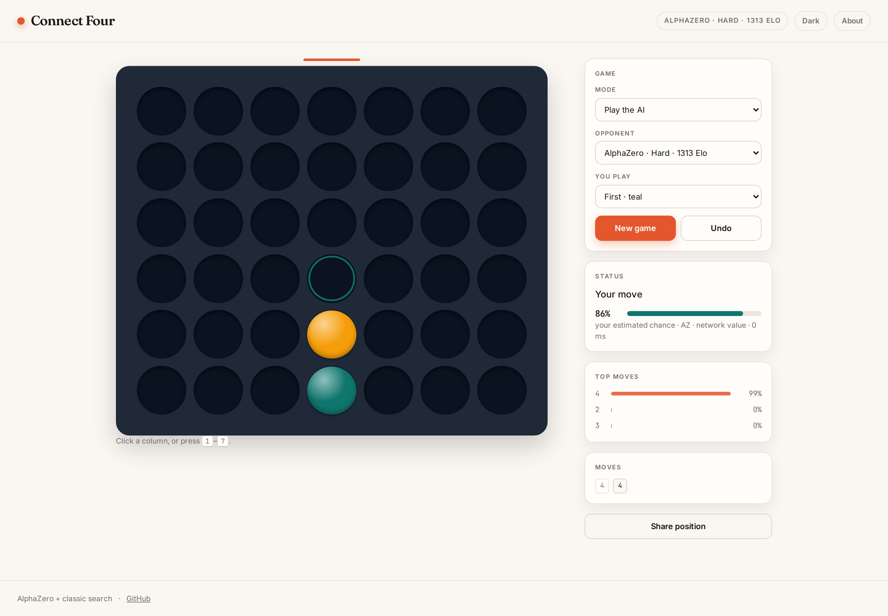
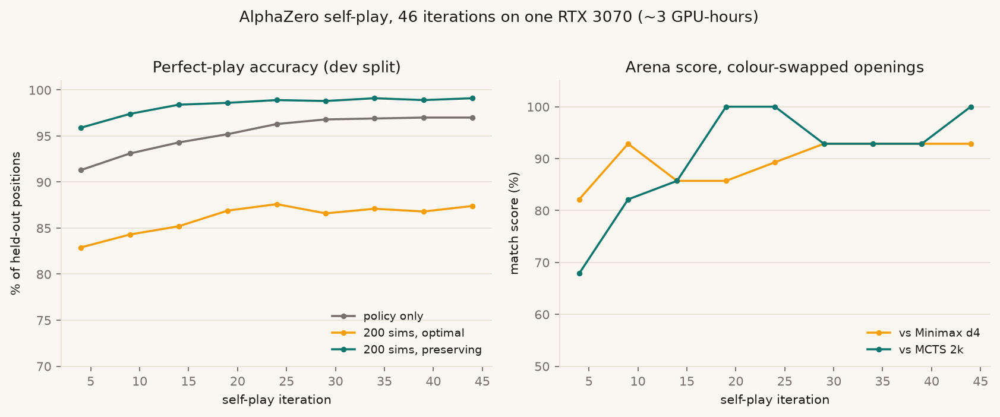

# Connect 4 — AlphaZero, evaluation and web

[](https://github.com/Swarsin/Connect-4-Game/actions/workflows/ci.yml)
[](https://github.com/Swarsin/Connect-4-Game/actions/workflows/deploy.yml)

**Play it: <https://swarsin.github.io/Connect-4-Game/>**



A Connect 4 engine with classical search baselines (Minimax, UCT MCTS), an AlphaZero
implementation trained by self-play, rigorous evaluation against perfect play, and a browser app
deployed at <https://swarsin.github.io/Connect-4-Game/>.

> **Status:** engine, classical agents, solver-backed evaluation harness, AlphaZero training
> pipeline and Kaggle plumbing are implemented and tested. A 3-hour local AlphaZero run is
> evaluated below, and int8 ONNX models for the browser are exported in `web/public/models/`.
> The web app is playable against both the classic bots (Minimax / MCTS) and the AlphaZero
> levels, with live evaluation and shareable positions, and is deployed to GitHub Pages.
> See `docs/architecture.md`.

## Model results (3-hour local run, RTX 3070)

46 iterations, 94k self-play games, 2.77M positions, 128x10 network (2.96M params).

| level | checkpoint | search | Elo (95% CI) | optimal / preserving on `c4_mixed_test` |
|---|---|---|---|---|
| Beginner | iter 0 | policy | 377 | — |
| Easy | iter 10 | policy | 1210 (1096–1355) | — |
| Medium | iter 45 | policy | 1210 (1086–1386) | 84.1% / 96.8% |
| Hard | iter 45 | 200 sims | 1313 (1182–1448) | 87.3% / 98.8% |
| Master | iter 45 | 800 sims | **1400 (1276–1571)** | **87.7% / 99.1%** |

Against the **perfect solver** at 200 simulations: **30 wins / 30 games as first player**, every
game lasting the maximum 41 plies; 0 wins / 30 as second player (mean 30.5 plies). The full
baseline pool is rated below it (MCTS 10k iterations 1052, Minimax depth 8 1024).

Shipped models are static int8 ONNX: 3.05 MB each (9.2 MB total), within 0.2 pp of fp32 accuracy,
~1.3x faster at batch 1 on CPU. Difficulty metadata: `web/public/models/levels.json`; export
report: `results/export.json`.

**Full write-up:** [docs/report.md](docs/report.md) — method, evaluation protocol, stage-by-stage
results, engineering and limitations.


## Why this is more than "an AI for Connect 4"

* **Measured against perfect play.** Connect 4 is solved, so every AI is scored on how often it
  picks a game-theoretically optimal move, not just "it beats me". Benchmarks and Elo tables are in
  `results/`.
* **Written from scratch.** Bitboard rules, Minimax, UCT and PUCT search, the policy/value network
  and the self-play trainer are all implemented in this repo (PyTorch for the network only).
* **Fast where it matters.** A bitboard engine (10x faster playouts, 38x faster search-node copies),
  batched lockstep self-play (40k games/hour on one consumer GPU) and a BN-folded, fp16,
  CUDA-graph inference path (2.2x over eager).
* **Reproducible.** Seeded, config-driven, resumable training; committed solver-labelled
  benchmarks; one command to regenerate every results table.

## Layout

```
src/c4/engine/      bitboard rules, plane encoding, symmetry
src/c4/agents/      Random, Minimax (+TT), UCT MCTS, perfect solver, AlphaZero
src/c4/alphazero/   network, PUCT, self-play, trainer, checkpoints, W&B
src/c4/eval/        arena, Elo, perfect-play benchmarks, CLI
src/c4/export/      ONNX export, parity checks, int8/fp16 quantisation
configs/            main / smoke / local training configs
data/benchmarks/    solver-labelled position sets (committed)
legacy/             the original pygame desktop game (frozen)
web/                Vite + React + TypeScript site (classic bots + AlphaZero levels)
docs/report.md     technical report (method, evaluation, results, limitations)
docs/architecture.md, docs/evaluation.md, docs/conventions.md
```

## Quick start

```bash
python -m venv .venv && source .venv/bin/activate
pip install -e ".[dev]"          # add ,train / ,eval / ,export as needed

# play bots / benchmark them
python -m c4.eval.cli play "minimax:d=6" random -n 50
python -m c4.eval.cli benchmark "minimax:d=8" --file data/benchmarks/c4_mixed_test.jsonl
python -m c4.eval.cli report

# perfect-play ground truth (builds Pons' solver into third_party/, gitignored)
scripts/build_solver.sh
python scripts/download_benchmarks.py
python scripts/make_benchmark.py

# train AlphaZero (smoke test on CPU, main run on GPU/Kaggle)
python -m c4.alphazero.train --config configs/smoke.yaml --resume none
python -m c4.alphazero.train --config configs/main.yaml --resume auto
```

`notebooks/kaggle/train.ipynb` wraps the main run for Kaggle (GPU + internet, `WANDB_API_KEY`
secret); it resumes from the latest W&B checkpoint artifact between sessions.

## Results so far

Elo in the solver-grounded match pool (anchor `random = 0`):

| agent | Elo |
|---|---|
| AlphaZero, 800 simulations | 1400 |
| AlphaZero, 200 simulations | 1313 |
| MCTS 10k iterations | 1052 |
| Minimax depth 8 | 1024 |
| Minimax depth 6 | 1010 |
| Minimax depth 4 | 940 |
| MCTS 2k iterations | 936 |
| Minimax depth 2 | 837 |
| random | 0 |

Perfect-play accuracy on `c4_mixed_test` (3,761 positions): AlphaZero at 800 simulations picks an
optimal move in **87.7%** of positions and preserves the result in **99.1%**; Minimax depth 8
86.5% / 94.9%; MCTS 2,000 iterations 83.6% / 94.7%. Full tables: `results/README.md`.



The legacy pygame game is untouched and still runs from `legacy/`.
