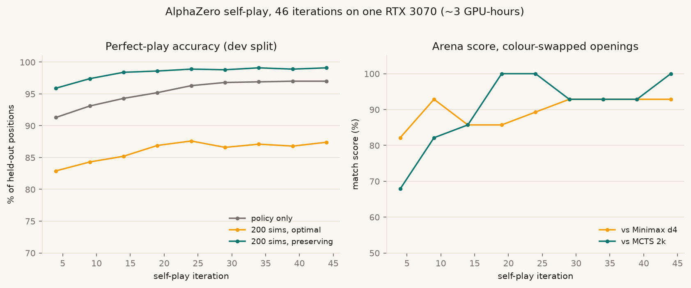
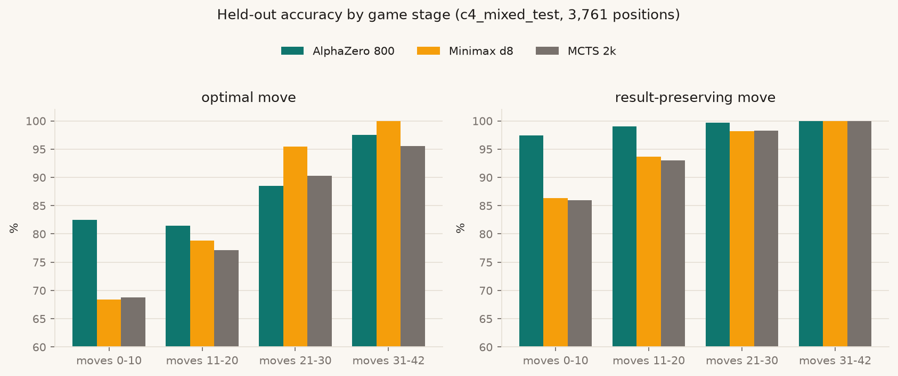
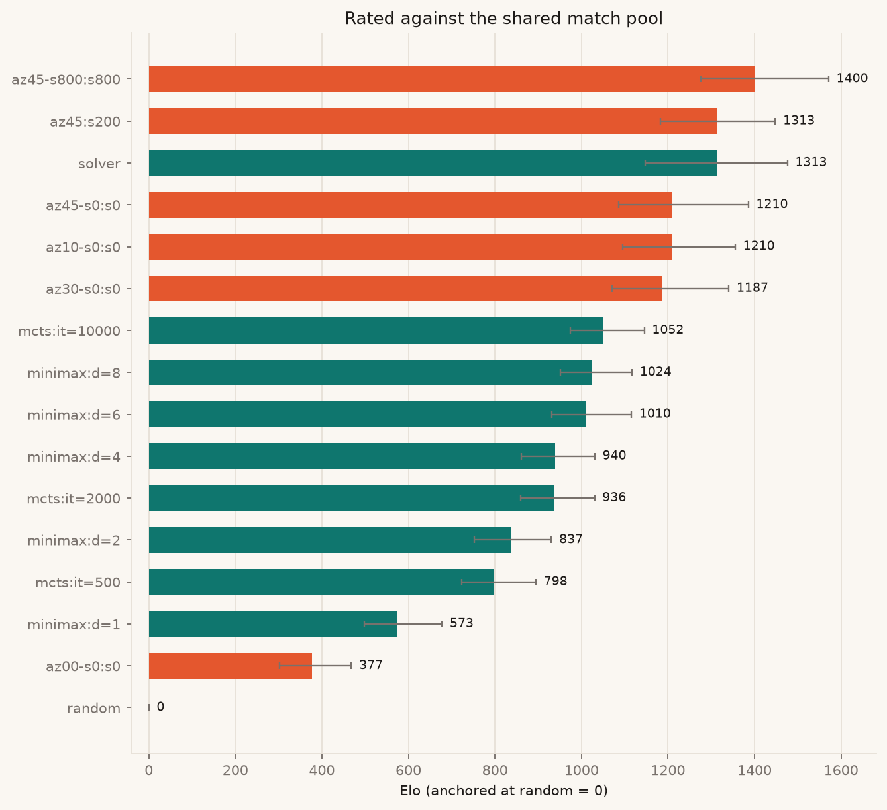
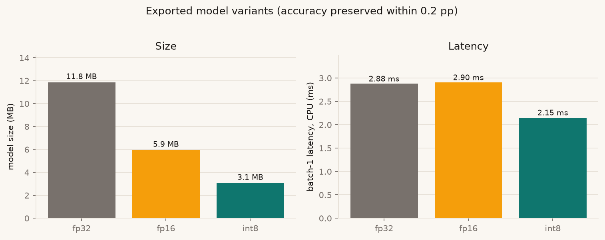

# Connect 4 with AlphaZero: engine, evaluation and browser deployment

**Live demo:** <https://swarsin.github.io/Connect-4-Game/>  
**Code:** <https://github.com/Swarsin/Connect-4-Game>

This report describes a Connect 4 project built around a simple question: can a policy/value
network trained by self-play beat well-tuned classical search, and can I *prove* it with numbers
rather than anecdotes? Connect 4 is a good testbed because it is solved: a perfect solver provides
ground truth for every position, so both classical and learned agents can be scored on exactly the
same scale.

The project has four parts:

1. a bitboard rules engine with a reference-tested implementation;
2. Minimax and UCT Monte Carlo tree search baselines;
3. an AlphaZero-style agent trained from self-play, with batched PUCT;
4. a browser application that runs the trained network locally with ONNX Runtime Web.

The headline result: a 3-hour training run on a single RTX 3070 produces an agent that scores
**1,400 Elo** in the project's match pool, picks a game-theoretically optimal move in **87.7%** of
held-out positions and preserves the game result in **99.1%**, and wins **30/30** games as first
player against a perfect solver. Against the same pool, Minimax depth 8 is rated 1,024 and MCTS
with 10,000 rollouts 1,052.

---

## 1. Why Connect 4

Connect 4 has roughly 4.5 trillion legal positions, which is far too many to tabulate, but it is
small enough for a strong solver. That combination makes it possible to:

- measure move quality against perfect play, not just win rate against other bots;
- compare a learned policy and a hand-written heuristic on identical positions;
- keep training and inference cheap enough to iterate on a single consumer GPU.

It is also the game that motivated the project: the starting point was a pygame implementation with
Minimax and MCTS written during CS50's AI course, and the goal was to take the same problem and
build the evaluation and learning machinery properly.

---

## 2. System overview

```
engine/      bitboard rules, plane encoding, symmetry
agents/      Random, Minimax, UCT MCTS, perfect solver, AlphaZero
alphazero/   network, PUCT, self-play, trainer, checkpoints
eval/        arena, Elo, solver benchmarks, batched GPU evaluation
export/      ONNX export, parity checks, int8 quantisation
web/         TypeScript engine, PUCT + ORT Web worker, React UI
```

Everything except PyTorch, ONNX Runtime and the React toolchain is implemented in this repository.
The rules engine, search algorithms, training loop, evaluation harness and browser search are all
written from scratch.

---

## 3. Rules engine

The engine uses a bitboard in the style of Pascal Pons' solver: seven columns of seven bits, where
the seventh bit is a sentinel that prevents shifted patterns from wrapping between columns. A move
is two integer operations (`current ^= mask; mask |= mask + bottom[col]`) and undo is their
inverse. Win detection is four shift-and-mask tests; "winning cells" uses shifted conjunctions to
find holes that complete a line.

The legacy implementation represented the board as seven Python `Stack` objects and deep-copied the
whole structure at every search node. Replacing it with two integers changed the cost profile
substantially:

| workload | bitboard | legacy stack board | speed-up |
|---|---:|---:|---:|
| random self-play games / second | 21,408 | 2,051 | 10.4x |
| search node (copy + play) / second | 1,027,823 | 26,787 | 38.4x |

Correctness is enforced in two ways. First, a naive 2D-list reference implementation is compared
against the bitboard on random games and on 10,000 Hypothesis-generated move sequences. Second, a
shared fixture file (`data/fixtures/engine_cases.json`) records 5,842 positions with legal moves,
winner, side to move, immediate wins and the neural input planes; the TypeScript engine must
reproduce it exactly. That fixture is what makes the browser implementation trustworthy rather than
a lookalike.

---

## 4. Classical baselines

**Minimax** is negamax with alpha-beta pruning, a transposition table keyed by the position, and
centre-first move ordering. The evaluation scores all 69 windows of four cells symmetrically for
both players (three-in-a-window +5, two +2, opponent three −4, opponent two −2, plus a centre
column term). The original implementation only scored the AI's own lines, which made it blind to
opponent threats; that is fixed here.

**UCT MCTS** uses random rollouts and an iteration budget rather than wall-clock time, so results
are reproducible. The original implementation had three bugs that made it weak:

1. backpropagation never changed perspective between players, so every node received the same
   score;
2. simulations mutated shared player objects, so the side to move drifted across rollouts;
3. tree reuse compared an integer to `Node` objects and never fired.

All three are fixed, and the search now derives the side to move from the board and reuses the
subtree when the next position extends the previous root.

The two baselines are deliberately strong: Minimax depth 8 searches long enough to expose most
tactical mistakes, and MCTS at 10,000 rollouts is a meaningful opponent.

---

## 5. AlphaZero

### Network

The network is a small residual policy/value model:

- input: two planes of 6×7, one for the side to move and one for the opponent, row 0 at the bottom;
- trunk: 3×3 convolution, batch norm, ReLU, then 10 residual blocks (conv–BN–ReLU, conv–BN);
- policy head: 1×1 convolution to 2 channels, flatten, linear to 7 logits;
- value head: 1×1 convolution to 1 channel, flatten, 64-unit hidden layer, tanh output.

The main configuration has 128 channels and 2.96 million parameters (11.8 MB in fp32). Legal moves
are masked before the softmax. The value is always from the perspective of the side to move.

### Search

PUCT selects moves with

```
score(a) = Q(a) + c_puct * P(a) * sqrt(sum N) / (1 + N(a))
```

with `c_puct = 2`, first-play urgency for unvisited moves, and Dirichlet noise at the root during
self-play. Values are negated on backup, so each node stores statistics from the perspective of the
player to move. The tree is reused between moves during a game.

The key implementation choice is that search runs over **many games in lockstep**. Each simulation
step descends one leaf per active game, all leaves are evaluated in one batched network call, and
the results are backed up. That turns hundreds of small forward passes into a handful of large ones
and keeps the GPU busy while Python walks the trees.

### Self-play and training

Self-play uses 512 concurrent games (4 workers × 128), 200 simulations per move, temperature 1 for
the first 12 plies and 0 afterwards, and tree reuse. Each position stores the input planes, the root
visit distribution, the final game result and the root value. Training samples batches of 1,024,
applies a 50% chance of mirroring the position and policy, and uses SGD with momentum (0.02, step
decay at iterations 25 and 38) for six gradient steps per new position. The replay buffer holds up
to one million positions. Checkpoints include the model, optimiser, scaler, RNG states, counters and
buffer, so a session can be interrupted and resumed exactly.

The 3-hour run used 46 iterations and 94,208 self-play games (2.77 million training positions).
Throughput improved during the run as the inference path was optimised (Section 6).

### Making inference fast

A naive fp32 forward pass on a small batch is dominated by kernel-launch overhead: roughly 70 tiny
kernels per evaluation. Three changes addressed that:

1. **Fold batch norm into the preceding convolutions** for the inference copy;
2. **Run inference in fp16** on CUDA;
3. **Capture one CUDA graph per batch-size bucket** and replay it, so the whole forward pass is a
   single launch.

With the 128×10 network, 200 simulations and 128 parallel games per worker, that raised single-worker
self-play throughput from **5,878 to 12,835 games/hour** (2.2x). Four workers sustain **40,784
games/hour** in the benchmark, and the 3-hour run averaged about 32,500 games/hour including
training, evaluation and checkpointing.

---

## 6. Evaluation methodology

This is the part that makes the project useful as more than a demo.

### Perfect-play ground truth

Pascal Pons' solver is built from source as an external tool (AGPL-3.0; it is never committed or
shipped). It returns a score for every legal move from the side to move's perspective:

- positive: the side to move can force a win, larger is faster;
- zero: draw with perfect play;
- negative: the side to move loses.

Every benchmark position stores all seven scores, so training and evaluation do not need the solver
at runtime.

### Benchmarks

- **Pons sets** (`Test_L3_R1` … `Test_L1_R3`): 1,000 positions each, from endgame to opening.
- **Mixed set**: 4,773 positions sampled evenly across plies 0–40 from games between random,
  Minimax depth 1–6 and MCTS agents, with 15% random moves. Positions are de-duplicated modulo
  mirror images and split by game into 1,012 dev and 3,761 test positions.

Two metrics are reported for every position:

- **optimal move**: the chosen move has the maximum solver score;
- **result-preserving move**: the chosen move keeps the theoretical result, even if it is not the
  fastest win.

The second metric matters: a draw that stays a draw is often as valuable as a faster win, and a
slow win is still a win.

### Elo

Matches use a fixed opening schedule with colours swapped. Every game is stored, and ratings are
fitted with a Bradley–Terry model (minorisation–maximisation) with draws counted as half a win,
a small prior so a perfect record stays finite, and 200 bootstrap resamples for confidence
intervals. `random` is anchored at 0.

The baseline pool contains random, Minimax at depths 1/2/4/6/8, and UCT at 500/2,000/10,000
rollouts. Adding the AlphaZero agents and the solver to the same pool gives one comparable scale.

### Honest caveats

Elo depends on the opponent panel. The AlphaZero points come from 14-game arena sets against three
opponents, so their confidence intervals are wide; they say "clearly stronger than Minimax depth 8
and MCTS 10k in this pool", not "1,400 Elo universally". The solver games use a solver that chooses
randomly among optimal moves, which avoids making the benchmark depend on one particular optimal
line.

---

## 7. Results

### Training



The left panel shows held-out accuracy during training. Policy-only play (no search) starts at 91%
result-preserving and reaches 97%; adding 200 simulations takes it to 99%. The right panel shows
match scores against two fixed opponents. Both curves flatten after roughly 30 iterations, which is
expected for a 3-hour run: the remaining gains would come from more games, a larger network or a
different value target, not from more gradient steps on the same buffer.

### Held-out accuracy

On the 3,761-position test split:

| agent | optimal | result-preserving |
|---|---:|---:|
| AlphaZero, policy only | 84.1% | 96.8% |
| AlphaZero, 200 sims | 87.3% | 98.8% |
| **AlphaZero, 800 sims** | **87.7%** | **99.1%** |
| Minimax depth 8 | 86.5% | 94.9% |
| Minimax depth 4 | 82.9% | 94.0% |
| MCTS 2,000 rollouts | 83.6% | 94.7% |
| Random | 41.5% | 71.0% |



The stage breakdown explains the overall picture. AlphaZero is much better in the opening and early
middlegame (82.5% vs 68.4% optimal at moves 0–10) because it has learned positional preferences
that Minimax's hand-written heuristic does not encode. Minimax depth 8 is better in the late
middlegame (95.5% vs 88.5% at moves 21–30), where deep tactical search dominates. By the endgame
both are close to perfect, and AlphaZero preserves the result in 100% of positions from move 31 on.
That is the expected trade-off between a learned prior and exhaustive search, and it is visible in
the numbers rather than hidden by an aggregate.

### Endgame benchmark

On Pons' `Test_L3_R1` (endgame positions), AlphaZero at 800 simulations reaches **93.8% optimal /
99.8% preserving**, compared with **99.6% / 99.7%** for Minimax depth 8 and **95.8% / 99.7%** for
MCTS 2,000. Classical search wins the pure endgame, which is consistent with the stage breakdown:
when the remaining tree is small, depth-first search is the right tool.

### Match play and Elo

| agent | Elo (95% CI) | games |
|---|---:|---:|
| AlphaZero, 800 sims | **1400** (1276–1571) | 42 |
| AlphaZero, 200 sims | 1313 (1182–1448) | 102 |
| Perfect solver | 1313 (1148–1476) | 60 |
| MCTS 10,000 rollouts | 1052 (974–1145) | 784 |
| Minimax depth 8 | 1024 (952–1117) | 868 |
| Minimax depth 6 | 1010 (932–1115) | 784 |
| Minimax depth 4 | 940 (860–1031) | 868 |
| MCTS 2,000 rollouts | 936 (859–1030) | 868 |
| Minimax depth 2 | 837 (753–930) | 784 |
| Random | 0 | 784 |



At 200 simulations the agent scores 0.929 against Minimax depth 4, 0.929 against depth 8 and 0.857
against MCTS 2,000 in colour-swapped 14-game sets. The measured Elo follows: the agent is stronger
than every classical baseline in this pool, and the 800-simulation version is stronger still.

### Against a perfect player

With the solver playing the other side:

| colour | games | wins | draws | losses | mean length |
|---|---:|---:|---:|---:|---:|
| AlphaZero first | 30 | **30** | 0 | 0 | 41.0 |
| AlphaZero second | 30 | 0 | 0 | 30 | 30.5 |

As first player it wins every game, and every win takes the maximum 41 plies, which is the length of
a perfect first-player win from the empty board. As second player it loses every game, as it must
against perfect play, but it survives to a mean of 30.5 plies. This is a useful asymmetry: the
value/policy learned the winning side of the opening well, but its defensive technique in a
theoretically lost position is not optimal. That is a concrete target for a longer run or for
training with more weight on defending lost positions.

### Browser export

The final checkpoint is exported to ONNX with batch norm folded into the convolutions:

| variant | size | CPU latency, batch 1 | result-preserving at 200 sims |
|---|---:|---:|---:|
| fp32 | 11.8 MB | 2.88 ms | 99.0% |
| fp16 | 5.9 MB | 2.90 ms | 99.0% |
| **int8** | **3.05 MB** | **2.15 ms** | **99.0%** |



Static int8 quantisation changes result-preserving accuracy by at most 0.2 percentage points on the
mixed test, while making the model 3.9× smaller and about 1.3× faster at batch 1. Policy agreement
with fp32 is 98% and the mean total-variation distance is 0.012, so the exported model plays
essentially the same moves. All five difficulty levels fit in **9.2 MB**.

---

## 8. Browser application

The site is a React/TypeScript application with a Vite build, deployed to GitHub Pages. The rules
engine is a direct TypeScript port of the Python engine, validated against the 5,842 shared
fixtures; the AI runs in a Web Worker so the page never blocks.

The AlphaZero path uses ONNX Runtime Web (wasm, one thread) and a TypeScript PUCT implementation.
The PUCT port is tested against the Python reference on 50 positions at 200 simulations and picks
the **same move in 50/50 cases**. Network policy and value match the Python export within 5e-3 on
50 fixture positions. The search uses the same tie-breaking, backup signs and selection formula as
the training code.

Measured locally in Chromium:

| level | search | latency |
|---|---|---:|
| Medium | network only | ~60 ms |
| Hard | 200 simulations | ~1.2 s |
| Master | 800 simulations | ~3.2 s |

The first AlphaZero move also downloads the ORT wasm runtime (14.8 MB, lazy) and the 3 MB model;
after that, sessions and per-position evaluations are cached. Classic Minimax/MCTS levels do not
load any of it, so the initial page stays small.

The interface shows the network's value as a win-probability estimate for AlphaZero levels, and a
clearly labelled heuristic estimate for the classic bots. The top-moves panel shows the network
policy or the search visit distribution. Positions are encoded in the URL, so any board is
shareable.

---

## 9. Limitations

- **Training scale.** The result is a 3-hour run on one consumer GPU, not a multi-day run. More
  games and a larger network would likely improve the opening and defensive play.
- **No ablations yet.** Mirror augmentation, simulation budget, network size and value target have
  not been isolated experimentally. The training curves are descriptive, not causal.
- **No learned-baseline comparison.** PPO/DQN would test whether the improvement comes from
  AlphaZero specifically or from any neural agent with search.
- **Wide Elo intervals.** Arena sets are 14 games per opponent; the ordering is clear but the exact
  ratings are not precise.
- **Browser performance.** Single-threaded wasm is a GitHub Pages constraint (no COOP/COEP headers).
  WebGPU or batched leaf evaluation would reduce Master-level latency.
- **Defensive play.** The 0/30 record as second player against the solver is expected, but the mean
  survival of 30.5 plies shows there is room to defend lost positions better.
- **No online play or accounts.** The deployed app is single-device; the original pygame version had
  a local SQLite leaderboard, which was deliberately left out of the browser build.

---

## 10. What I would do next

1. **Longer Kaggle run** (2–3 sessions, ~30 GPU-hours) with the same config, tracking Elo and
   benchmark accuracy against GPU-hours.
2. **Ablations** at equal GPU time: mirror on/off, 50/200/800 self-play simulations, 64×5 vs
   128×10, value target `z` vs `(z + q)/2`.
3. **PPO baseline** trained under the same compute budget, to answer "why AlphaZero?" directly.
4. **Interpretability probes** on the learned representation: immediate wins, forced blocks, open
   threes, threat parity, solver outcome, with random-weight and raw-input controls.
5. **Defensive training**: oversample positions where the side to move is theoretically lost and
   reward longer survival.
6. **WebGPU/batched PUCT** for lower Master latency, and a service worker for the runtime/model.

---

## 11. Reproducing

```bash
# engine and unit tests
pip install -e ".[dev,eval,train,export]"
pytest -m "not solver and not slow"

# ground truth and benchmarks (builds Pons' solver into third_party/)
scripts/build_solver.sh
python scripts/download_benchmarks.py
python scripts/make_benchmark.py

# train (GPU recommended; smoke config runs on CPU)
python -m c4.alphazero.train --config configs/smoke.yaml --resume none
python -m c4.alphazero.train --config configs/main.yaml --resume auto

# evaluate a checkpoint (batched GPU benchmarks, arena, solver games, Elo refit)
python -m c4.eval.az_report --ckpt runs/az-local/models/model_iter_0045.pt \
    --name az45 --sims 0 200 800 --arena "minimax:d=4" "minimax:d=8" \
    "mcts:it=2000" --arena-sims 200 --solver-games 30 --elo

# figures and the aggregate results table
python -m c4.eval.plots
python -m c4.eval.cli report

# web app
cd web && npm ci && npm run dev
```

The committed `results/` directory contains the evaluation JSON, the figures and a compact
per-iteration training log (`results/training/az-local.jsonl`), so the report can be regenerated
without re-running training.

---

## 12. Acknowledgements

- Pascal Pons' Connect 4 solver and test sets, used as an external evaluation oracle (AGPL-3.0).
- The AlphaZero and MuZero papers for the algorithm and the PUCT formulation.
- PyTorch, ONNX Runtime, React, Vite and Playwright for the infrastructure.
